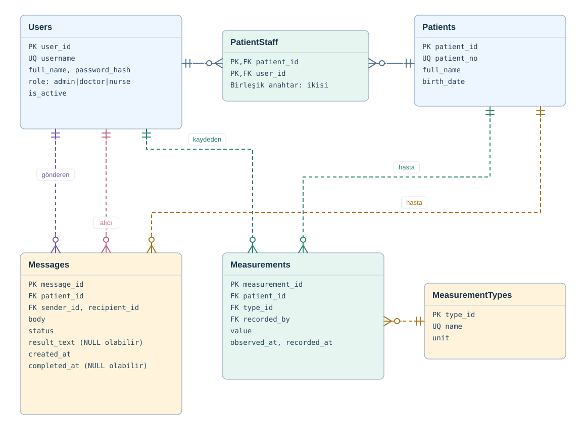

> 🇬🇧 **English** · 🇹🇷 Türkçe sürüm aşağıdadır.

# 3.6.2 · ER Diagram — Crow’s Foot ER diagram

The many-to-many relationship between patients and staff is resolved with PatientStaff. **The ER diagram uses Crow’s Foot notation.** Every dependent row requires its parent entity; a parent may have no dependent records. In all eight relationships the parent end has a **double bar** and the dependent end has a **circle and crow’s foot**. This choice matches the notation in the given [VYS02 notes](https://github.com/celalceken/DatabaseManagementSystems/blob/master/VYS02.md).

Editable source: [`diagrams/er-uml.drawio`](diagrams/er-uml.drawio)

*Figure 1. Six tables and eight relationships in Crow’s Foot notation. The double bar at the parent end means exactly one; the circle and crow’s foot at the dependent end mean zero or many. The PatientStaff relationships are identifying. Source: project design. (Diagram labels: hasta = patient, kaydeden = recorded by, gönderen = sender, alıcı = recipient.)*

**Notation:** double bar = exactly one · circle + crow’s foot = zero or many · solid line = identifying relationship · dashed line = non-identifying relationship · **PK** primary key · **FK** foreign key · **UQ** unique field

For example, the double bar at the Patients end states that **every measurement belongs to exactly one patient**; the circle and crow’s foot at the Measurements end state that **a patient may have zero or many measurements**. These are multiplicity markers, not direction arrows.

**Solid lines:** Users–PatientStaff and Patients–PatientStaff are identifying relationships; the two foreign keys form the composite primary key of PatientStaff. **Dashed lines:** in the other six relationships the foreign key is not part of the dependent table’s primary key. A dashed line does not mean “the link is optional”; mandatory participation is shown by the end symbols.

**Table 3. ER relationships and foreign key mappings**

| Relationship · parent → dependent | Key mapping · PK ← FK | Rule |
|---|---|---|
| Users → PatientStaff | `users.user_id ← patient_staff.user_id` | K05–K07 |
| Patients → PatientStaff | `patients.patient_id ← patient_staff.patient_id` | K05–K07 |
| Patients → Measurements | `patients.patient_id ← measurements.patient_id` | K10–K11 |
| MeasurementTypes → Measurements | `measurement_types.type_id ← measurements.type_id` | K09, K12 |
| Users → Measurements (recorded by) | `users.user_id ← measurements.recorded_by` | K13 |
| Patients → Messages | `patients.patient_id ← messages.patient_id` | K16–K17 |
| Users → Messages (sender) | `users.user_id ← messages.sender_id` | K18 |
| Users → Messages (recipient) | `users.user_id ← messages.recipient_id` | K19 |

There are two separate relationships between Users and Messages: **sender** and **recipient**. Crossing lines do not create a new relationship. Doctors and nurses are different roles in the same Users table; role restrictions beyond the ER multiplicities are stated in K18–K19.

---

> 🇹🇷 **Türkçe**

# 3.6.2 · ER Diagram — Crow’s Foot ER diyagramı

Hasta–personel arasındaki çoktan çoğa ilişki PatientStaff ile çözülmüştür. **ER diyagramı Crow’s Foot (karga ayağı) gösterimini kullanır.** Her bağlı satırın ana varlığı zorunludur; ana varlığın hiç bağlı kaydı bulunmayabilir. Sekiz ilişkinin ana ucunda **çift çizgi**, bağlı ucunda **daire ve karga ayağı** vardır. Bu seçim verilen [VYS02 notundaki](https://github.com/celalceken/DatabaseManagementSystems/blob/master/VYS02.md) gösterimle uyumludur.

Düzenlenebilir kaynak: [`diagrams/er-uml.drawio`](diagrams/er-uml.drawio)

*Şekil 1. Crow’s Foot gösteriminde altı tablo ve sekiz ilişki. Ana uçtaki çift çizgi tam biri, bağlı uçtaki daire ve karga ayağı sıfır veya çoğu gösterir. PatientStaff ilişkileri tanımlayıcıdır. Kaynak: proje tasarımı.*

**Gösterim:** çift çizgi = tam bir · daire + karga ayağı = sıfır veya çok · düz çizgi = tanımlayıcı ilişki · kesikli çizgi = tanımlayıcı olmayan ilişki · **PK** birincil anahtar · **FK** yabancı anahtar · **UQ** benzersiz alan

Örneğin Patients ucundaki çift çizgi, **her ölçümün tam bir hastaya ait olduğunu**; Measurements ucundaki daire ve karga ayağı, **bir hastanın sıfır veya çok sayıda ölçümü olabileceğini** belirtir. Bunlar yön oku değil, ilişki çokluğu işaretleridir.

**Düz çizgiler:** Users–PatientStaff ve Patients–PatientStaff tanımlayıcı ilişkilerdir; iki yabancı anahtar PatientStaff’ın birleşik birincil anahtarını oluşturur. **Kesikli çizgiler:** Diğer altı ilişkide yabancı anahtar, bağlı tablonun birincil anahtarına dahil değildir. Kesikli çizgi “bağlantı isteğe bağlı” demek değildir; zorunluluk uç sembolleriyle gösterilir.

**Tablo 3. ER ilişkileri ve yabancı anahtar eşleşmeleri**

| İlişki · ana → bağlı | Anahtar eşleşmesi · PK ← FK | Kural |
|---|---|---|
| Users → PatientStaff | `users.user_id ← patient_staff.user_id` | K05–K07 |
| Patients → PatientStaff | `patients.patient_id ← patient_staff.patient_id` | K05–K07 |
| Patients → Measurements | `patients.patient_id ← measurements.patient_id` | K10–K11 |
| MeasurementTypes → Measurements | `measurement_types.type_id ← measurements.type_id` | K09, K12 |
| Users → Measurements (kaydeden) | `users.user_id ← measurements.recorded_by` | K13 |
| Patients → Messages | `patients.patient_id ← messages.patient_id` | K16–K17 |
| Users → Messages (gönderen) | `users.user_id ← messages.sender_id` | K18 |
| Users → Messages (alıcı) | `users.user_id ← messages.recipient_id` | K19 |

Users–Messages arasında **gönderen** ve **alıcı** olmak üzere iki ayrı ilişki vardır. Kesişen çizgiler yeni bir ilişki oluşturmaz. Doktor ve hemşire aynı Users tablosundaki farklı rollerdir; ER çokluklarına ek rol sınırlamaları K18–K19 ile belirtilmiştir.
