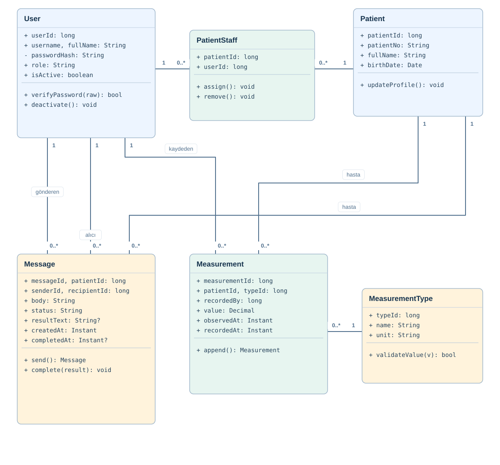

> 🇬🇧 **English** · 🇹🇷 Türkçe sürüm aşağıdadır.

# 3.6.2 · UML Class Diagram

*Figure 2. Typed attributes, behaviours and multiplicities of the same six entities. Sender and recipient are separate associations. Source: project design. (Diagram labels: hasta = patient, kaydeden = recorded by, gönderen = sender, alıcı = recipient.)*

The UML class diagram shows the attributes and behaviours of the same six entities. The multiplicities **1** and **0..*** are kept in UML; they express the same participation conditions as the double bar and circle/crow’s foot in the ER diagram. `+` marks a public member, `−` a private member and `?` a value that may be empty. Class attributes such as `userId` correspond to table columns such as `user_id`. Behaviours can be implemented in application services; they do not imply additional tables.

## Classes

| Class | Attributes | Behaviours |
|---|---|---|
| User | + userId: long · + username, fullName: String · − passwordHash: String · + role: String · + isActive: boolean | + verifyPassword(raw): bool · + deactivate(): void |
| PatientStaff | + patientId: long · + userId: long | + assign(): void · + remove(): void |
| Patient | + patientId: long · + patientNo: String · + fullName: String · + birthDate: Date | + updateProfile(): void |
| Message | + messageId, patientId: long · + senderId, recipientId: long · + body: String · + status: String · + resultText: String? · + createdAt: Instant · + completedAt: Instant? | + send(): Message · + complete(result): void |
| Measurement | + measurementId: long · + patientId, typeId: long · + recordedBy: long · + value: Decimal · + observedAt: Instant · + recordedAt: Instant | + append(): Measurement |
| MeasurementType | + typeId: long · + name: String · + unit: String | + validateValue(v): bool |

## Associations and multiplicities

| Association | Multiplicity |
|---|---|
| User — PatientStaff | 1 — 0..* |
| Patient — PatientStaff | 1 — 0..* |
| User — Measurement (recorded by) | 1 — 0..* |
| Patient — Measurement | 1 — 0..* |
| MeasurementType — Measurement | 1 — 0..* |
| Patient — Message | 1 — 0..* |
| User — Message (sender) | 1 — 0..* |
| User — Message (recipient) | 1 — 0..* |

---

> 🇹🇷 **Türkçe**

# 3.6.2 · UML Class Diagram — UML sınıf diyagramı

*Şekil 2. Aynı altı varlığın tipli özellikleri, davranışları ve çoklukları. Gönderen ve alıcı ayrı ilişkilerdir. Kaynak: proje tasarımı.*

UML sınıf diyagramı aynı altı varlığın özelliklerini ve davranışlarını gösterir. UML’de **1** ve **0..*** çoklukları korunmuştur; bunlar ER’deki çift çizgi ve daire/karga ayağıyla aynı katılım koşullarını anlatır. `+` dışarıya açık, `−` gizli üyeyi; `?` boş olabilen değeri belirtir. `userId` gibi sınıf alanları tablolardaki `user_id` alanlarına karşılık gelir. Davranışlar uygulama servislerinde gerçekleştirilebilir; ek tablo anlamına gelmez.

## Sınıflar

| Sınıf | Özellikler | Davranışlar |
|---|---|---|
| User | + userId: long · + username, fullName: String · − passwordHash: String · + role: String · + isActive: boolean | + verifyPassword(raw): bool · + deactivate(): void |
| PatientStaff | + patientId: long · + userId: long | + assign(): void · + remove(): void |
| Patient | + patientId: long · + patientNo: String · + fullName: String · + birthDate: Date | + updateProfile(): void |
| Message | + messageId, patientId: long · + senderId, recipientId: long · + body: String · + status: String · + resultText: String? · + createdAt: Instant · + completedAt: Instant? | + send(): Message · + complete(result): void |
| Measurement | + measurementId: long · + patientId, typeId: long · + recordedBy: long · + value: Decimal · + observedAt: Instant · + recordedAt: Instant | + append(): Measurement |
| MeasurementType | + typeId: long · + name: String · + unit: String | + validateValue(v): bool |

## İlişkiler ve çokluklar

| İlişki | Çokluk |
|---|---|
| User — PatientStaff | 1 — 0..* |
| Patient — PatientStaff | 1 — 0..* |
| User — Measurement (kaydeden) | 1 — 0..* |
| Patient — Measurement | 1 — 0..* |
| MeasurementType — Measurement | 1 — 0..* |
| Patient — Message | 1 — 0..* |
| User — Message (gönderen) | 1 — 0..* |
| User — Message (alıcı) | 1 — 0..* |
